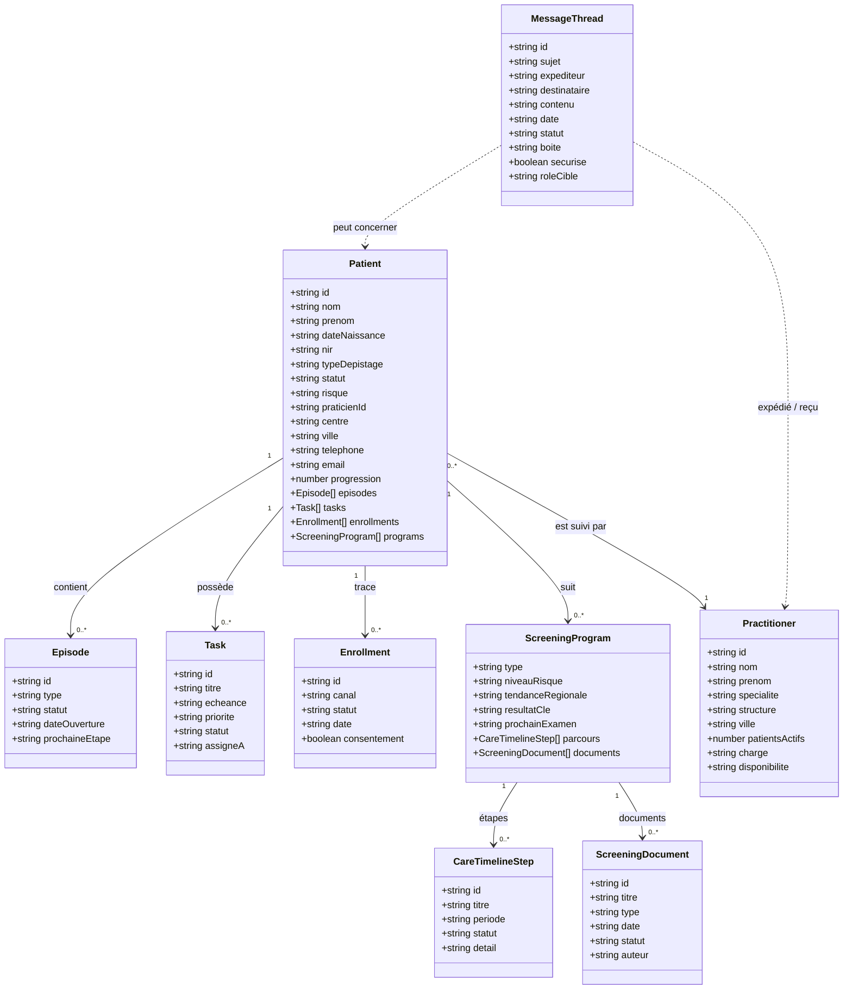
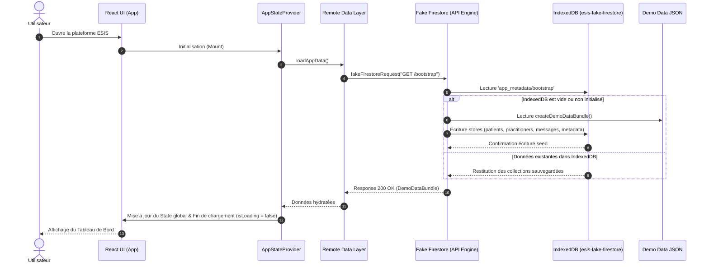
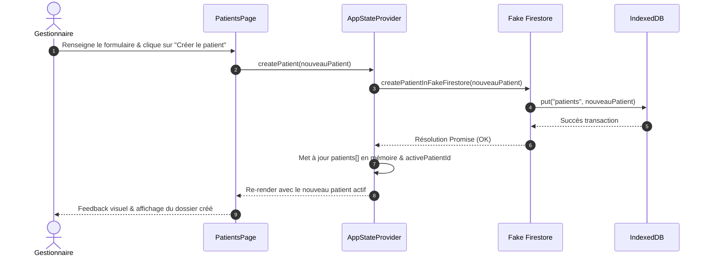
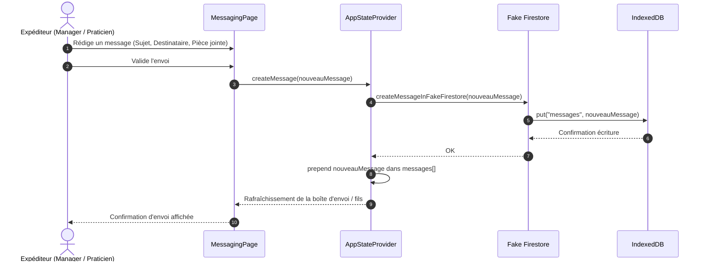
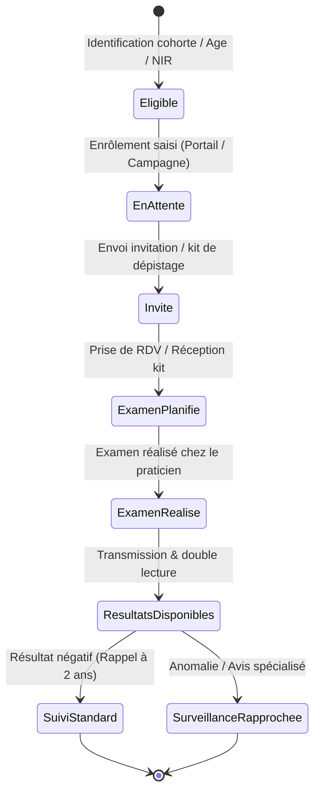

# Documentation Fonctionnelle et Architecture des Données ESIS

Ce document présente l'architecture fonctionnelle globale, le dictionnaire détaillé des données par objet, le cycle de vie métier ainsi que les diagrammes de flux UML Mermaid pour la plateforme **ESIS** (Enrôlement & Suivi des Dépistages Organisés).

---

## 1. Contexte & Périmètre Fonctionnel

ESIS est une application front-end de gestion et de suivi des campagnes de dépistage organisé des cancers (Sein, Colorectal, Col de l'utérus). Elle s'articule autour de 3 rôles métiers distincts :

1. **Gestionnaire / Coordinateur (`manager`)** :
   - Pilotage des cohortes, suivi des indicateurs clés (taux de participation, relances, alertes).
   - Enrôlement de nouveaux patients et suivi de leur parcours.
   - Assignation des tâches de coordination et gestion des anomalies.
2. **Professionnel de Santé / Praticien (`practitioner`)** :
   - Consultation des dossiers patients qui lui sont rattachés.
   - Validation des examens, télétransmission et lecture des comptes-rendus.
   - Échanges sécurisés avec la coordination et les patients.
3. **Patient (`patient`)** :
   - Consultation de son programme de dépistage personnalisé et de son calendrier.
   - Renseignement des formulaires de pré-dépistage et consentements.
   - Messagerie sécurisée avec l'équipe de coordination.

---

## 2. Architecture des Données & Relations

---

## 3. Dictionnaire Détaillé des Propriétés des Données par Objet

### 3.1. Objet `Patient`
Entité centrale représentant l'usager éligible ou enrôlé dans un ou plusieurs dépistages.

| Nom technique | Type | Exemple | Description / Valeurs autorisées |
| :--- | :--- | :--- | :--- |
| `id` | `string` | `"pt-1"` | Identifiant technique unique du patient. |
| `nom` | `string` | `"Lemoine"` | Nom de famille de l'usager. |
| `prenom` | `string` | `"Claire"` | Prénom de l'usager. |
| `dateNaissance` | `string` | `"14/05/1972"` | Date de naissance au format JJ/MM/AAAA. |
| `nir` | `string` | `"2 72 05 75 123 456 78"` | Numéro d'inscription au répertoire (Sécurité Sociale). |
| `typeDepistage` | `enum` | `"Sein"` | Type de dépistage principal rattaché : • `"Sein"` • `"Colorectal"` • `"Col utérus"` |
| `statut` | `enum` | `"Invité"` | Statut global dans la campagne en cours : • `"En attente"` • `"Invité"` • `"Examen réalisé"` • `"Résultats disponibles"` |
| `derniereVisite` | `string` | `"12/01/2026"` | Date du dernier contact ou examen de dépistage réalisé. |
| `prochainRappel` | `string` | `"12/01/2028"` | Échéance calculée du prochain rappel de dépistage. |
| `praticienId` | `string` | `"med-1"` | Référence (clé étrangère) vers le `Practitioner` référent. |
| `centre` | `string` | `"Centre de Radiologie Gambetta"` | Centre d'examen ou structure de soins rattachée. |
| `ville` | `string` | `"Bordeaux"` | Ville de résidence ou de prise en charge. |
| `telephone` | `string` | `"06 12 34 56 78"` | Numéro de téléphone mobile pour les notifications et relances. |
| `email` | `string` | `"claire.lemoine@email.fr"` | Adresse électronique pour l'accès portail et notifications. |
| `risque` | `enum` | `"Standard"` | Niveau d'évaluation du risque oncologique : • `"Standard"` • `"Modéré"` • `"Prioritaire"` |
| `canalPrefere` | `enum` | `"SMS"` | Canal de communication privilégié par l'usager : • `"SMS"` • `"Email"` • `"Courrier"` |
| `couverture` | `enum` | `"Assurance active"` | État des droits AMO / ALD : • `"Assurance active"` • `"Vérification requise"` |
| `progression` | `number` | `45` | Pourcentage de complétion du cycle en cours (0 à 100). |
| `medecinTraitant` | `string` | `"Dr Marc Fabre"` | Nom du médecin traitant déclaré. |
| `groupeSanguin` | `enum` | `"A+"` | Groupe sanguin et rhésus : • `"A+"`, `"A-"`, `"B+"`, `"B-"`, `"AB+"`, `"AB-"`, `"O+"`, `"O-"` |
| `allergies` | `string[]` | `["Pénicilline", "Iode"]` | Liste des allergies médicamenteuses ou de contact déclarées. |
| `antecedents` | `string[]` | `["Antécédent maternel cancer sein"]` | Antécédents médicaux personnels ou familiaux notables. |
| `traitements` | `string[]` | `["Lévothyrox 50µg"]` | Traitements médicamenteux en cours. |
| `constantes` | `object` | `{ imc: "22.4", tension: "12/8", ... }` | Données biométriques : `imc`, `tension`, `frequenceCardiaque`, `saturation`. |
| `situationCourante`| `string` | `"En attente de mammographie T2"` | Synthèse textuelle de la situation clinique actuelle. |
| `episodes` | `Episode[]` | `[...]` | Liste des campagnes / épisodes historiques de dépistage. |
| `tasks` | `Task[]` | `[...]` | Tâches de suivi et d'actions associées au dossier. |
| `enrollments` | `Enrollment[]` | `[...]` | Historique des canaux d'enrôlement et consentements. |
| `programs` | `ScreeningProgram[]` | `[...]` | Déroulement spécifique par organe (timeline, formulaires, documents). |

---

### 3.2. Objet `Practitioner`
Professionnel de santé impliqué (médecin traitant, radiologue, gynécologue, gastro-entérologue).

| Nom technique | Type | Exemple | Description / Valeurs autorisées |
| :--- | :--- | :--- | :--- |
| `id` | `string` | `"med-1"` | Identifiant unique du praticien. |
| `nom` | `string` | `"Fabre"` | Nom de famille du professionnel. |
| `prenom` | `string` | `"Marc"` | Prénom du professionnel. |
| `specialite` | `string` | `"Médecine générale"` | Spécialité médicale (ex: Radiologie, Gynécologie). |
| `structure` | `string` | `"Cabinet Médical Saint-Genès"` | Nom de l'établissement ou du cabinet d'exercice. |
| `ville` | `string` | `"Bordeaux"` | Ville d'exercice. |
| `patientsActifs`| `number` | `142` | Nombre total de patients suivis dans le cadre du dépistage. |
| `charge` | `enum` | `"Maîtrisée"` | Niveau de charge d'activité du praticien : • `"Faible"` • `"Maîtrisée"` • `"Élevée"` |
| `disponibilite`| `string` | `"Sous 48h"` | Délais de disponibilité pour la prise en charge ou avis. |

---

### 3.3. Objet `Episode`
Campagne ou cycle de dépistage daté pour un organe spécifique.

| Nom technique | Type | Exemple | Description / Valeurs autorisées |
| :--- | :--- | :--- | :--- |
| `id` | `string` | `"ep-1"` | Identifiant unique de l'épisode. |
| `type` | `enum` | `"Sein"` | Organe / programme concerné : • `"Sein"` • `"Colorectal"` • `"Col utérus"` |
| `statut` | `enum` | `"Examen planifié"` | Étape courante de l'épisode : • `"Invitation envoyée"` • `"Kit envoyé"` • `"Examen planifié"` • `"Résultats disponibles"` |
| `dateOuverture` | `string` | `"15/01/2026"` | Date de création de l'épisode (format JJ/MM/AAAA). |
| `prochaineEtape`| `string` | `"Réalisation mammographie"` | Action immédiatement attendue dans le parcours. |

---

### 3.4. Objet `Enrollment`
Canal d'entrée et validation du consentement du patient dans la campagne.

| Nom technique | Type | Exemple | Description / Valeurs autorisées |
| :--- | :--- | :--- | :--- |
| `id` | `string` | `"enr-1"` | Identifiant de l'enrôlement. |
| `canal` | `enum` | `"Portail"` | Canal d'initiation : • `"Portail"` • `"Téléphone"` • `"Cabinet"` • `"Campagne"` |
| `statut` | `enum` | `"Validé"` | État de conformité du dossier : • `"À valider"` • `"Validé"` • `"Incomplet"` |
| `date` | `string` | `"10/01/2026"` | Date d'enrôlement constatée. |
| `consentement` | `boolean` | `true` | Recueil explicite du consentement de l'usager (`true` / `false`). |

---

### 3.5. Objet `Task`
Tâche d'action assignée à un membre de l'équipe de coordination ou praticien.

| Nom technique | Type | Exemple | Description / Valeurs autorisées |
| :--- | :--- | :--- | :--- |
| `id` | `string` | `"tsk-1"` | Identifiant de la tâche. |
| `titre` | `string` | `"Relancer patiente non-répondante"` | Libellé explicite de l'action à mener. |
| `echeance` | `string` | `"28/02/2026"` | Date limite de réalisation. |
| `priorite` | `enum` | `"Haute"` | Degré d'urgence : • `"Basse"` • `"Normale"` • `"Haute"` |
| `statut` | `enum` | `"À faire"` | Avancement de la tâche : • `"À faire"` • `"En cours"` • `"Bloquée"` • `"Terminée"` |
| `assigneA` | `string` | `"Coordination Gironde"` | Entité ou professionnel en charge de la tâche. |

---

### 3.6. Objet `ScreeningProgram`
Déroulement clinique spécifique pour un programme de dépistage donné.

| Nom technique | Type | Exemple | Description / Valeurs autorisées |
| :--- | :--- | :--- | :--- |
| `type` | `enum` | `"Sein"` | Type d'organe : • `"Sein"` • `"Colorectal"` • `"Col utérus"` |
| `niveauRisque` | `enum` | `"Standard"` | Stratification du risque : • `"Standard"` • `"Surveillance rapprochée"` • `"Avis spécialisé"` |
| `tendanceRegionale` | `string` | `"+4.2% participation"` | Indicateur statistique régional comparatif. |
| `resultatCle` | `string` | `"ACR 2 (Normal)"` | Résultat synthétique de la dernière exploration. |
| `prochainExamen`| `string` | `"Janvier 2028"` | Échéance calendaire de la prochaine séance. |
| `historique` | `string[]` | `["2024: ACR 2", "2022: ACR 1"]` | Synthèse historique des examens antérieurs. |
| `parcours` | `CareTimelineStep[]` | `[...]` | Étapes chronologiques détaillées (voir ci-après). |
| `formulaires` | `object[]` | `[...]` | Questionnaires médicaux : `id`, `titre`, `statut` (`"À compléter"`, `"Complet"`, `"À revoir"`), `champs`. |
| `examensProposes`| `object[]` | `[...]` | Actes médicaux prescrits : `nom`, `justification`, `resultat`. |
| `documents` | `ScreeningDocument[]` | `[...]` | Pièces jointes et comptes-rendus médicaux. |

---

### 3.7. Objet `CareTimelineStep` (Sous-objet de `ScreeningProgram`)
Étape de la timeline du parcours de soins.

| Nom technique | Type | Exemple | Description / Valeurs autorisées |
| :--- | :--- | :--- | :--- |
| `id` | `string` | `"step-1"` | Identifiant de l'étape. |
| `titre` | `string` | `"Envoi du courrier d'invitation"` | Intitulé de l'étape. |
| `periode` | `string` | `"Janvier 2026"` | Période ou date de franchissement. |
| `statut` | `enum` | `"En cours"` | Positionnement dans la chronologie : • `"Précédent"` • `"En cours"` • `"Suivant"` |
| `detail` | `string` | `"Courrier envoyé avec étiquette code-barres"` | Précisions opérationnelles. |

---

### 3.8. Objet `ScreeningDocument`
Document médical ou administratif rattaché au parcours.

| Nom technique | Type | Exemple | Description / Valeurs autorisées |
| :--- | :--- | :--- | :--- |
| `id` | `string` | `"doc-1"` | Identifiant unique du document. |
| `titre` | `string` | `"Compte-rendu mammographie T2"` | Nom descriptif du document. |
| `type` | `enum` | `"Compte-rendu"` | Nature du document : • `"Compte-rendu"` • `"Résultat biologique"` • `"Préparation examen"` • `"Consentement"` |
| `date` | `string` | `"20/01/2026"` | Date de dépôt ou d'émission. |
| `statut` | `enum` | `"Disponible"` | Accessibilité du document : • `"Disponible"` • `"À signer"` • `"En attente"` |
| `aperçu` | `string` | `"Mammographie bilatérale sans anomalie suspecte"` | Extrait ou résumé textuel. |
| `indicateur` | `string` | `"ACR 2"` | Classification diagnostique clé. |
| `auteur` | `string` | `"Dr Valérie Martin (Radiologue)"` | Rédacteur ou organisme émetteur. |

---

### 3.9. Objet `MessageThread`
Fil de messagerie sécurisée échangé entre les utilisateurs.

| Nom technique | Type | Exemple | Description / Valeurs autorisées |
| :--- | :--- | :--- | :--- |
| `id` | `string` | `"msg-1"` | Identifiant unique du fil de discussion. |
| `sujet` | `string` | `"Confirmation de votre rendez-vous mammographie"` | Objet du message. |
| `expediteur` | `string` | `"Centre Régional de Dépistage"` | Identité affichée de l'émetteur. |
| `destinataire` | `string` | `"Claire Lemoine"` | Identité affichée du récepteur. |
| `aperçu` | `string` | `"Bonjour, nous confirmons votre créneau le..."` | Résumé affiché dans la liste des messages. |
| `contenu` | `string` | `"Bonjour Madame Lemoine, votre rendez-vous est prévu..."` | Corps complet du message. |
| `date` | `string` | `"18/02/2026 14:30"` | Horodatage d'envoi. |
| `statut` | `enum` | `"Non lu"` | État de lecture : • `"Lu"` • `"Non lu"` • `"Envoyé"` • `"Brouillon"` |
| `boite` | `enum` | `"Réception"` | Emplacement de la boîte : • `"Réception"` • `"Envoyés"` • `"Brouillons"` • `"Archives"` |
| `securise` | `boolean` | `true` | Indicateur de chiffrement et conformité MSSanté (`true` / `false`). |
| `importance` | `enum` | `"Normale"` | Degré d'importance : • `"Normale"` • `"Haute"` |
| `roleCible` | `enum` | `"patient"` | Profil ciblé par le message : • `"manager"` • `"patient"` • `"practitioner"` • `"all"` |
| `piecesJointes` | `object[]` | `[{ nom: "Convocation.pdf", taille: "1.2 Mo" }]` | Liste optionnelle de documents joints. |

---

## 4. Architecture Technique de Persistance (In-Browser Storage)

L'application émule un backend Firestore sans nécessiter de serveur distant via une couche **Fake Firestore** s'appuyant sur l'API native **IndexedDB** du navigateur.

### 4.1. Magasins IndexedDB (`esis-fake-firestore`, v1)

| Store | Clé (`keyPath`) | Description |
| :--- | :--- | :--- |
| `patients` | `id` | Documents patients complets avec sous-collections dénormalisées |
| `practitioners` | `id` | Professionnels de santé partenaires |
| `messages` | `id` | Fils de discussion de la messagerie |
| `app_metadata` | `id` | Métadonnées de session (`bootstrap` : rôle actif, profil, IDs courants) |

### 4.2. Hiérarchie d'accès aux données

1. **UI Components** ([patients-page.tsx](file:///c:/Users/Quang/Documents/GitHub/esis/src/app/components/patients-page.tsx), [messaging-page.tsx](file:///c:/Users/Quang/Documents/GitHub/esis/src/app/components/messaging-page.tsx), etc.)
2. **React Context** ([app-state.tsx](file:///c:/Users/Quang/Documents/GitHub/esis/src/app/app-state.tsx)) : Gestion de l'état réactif en mémoire.
3. **Bridge Remote Data** ([remote-data.ts](file:///c:/Users/Quang/Documents/GitHub/esis/src/app/lib/remote-data.ts)) : Passerelle d'abstraction API (`loadAppData()`, `loadStoredCollections()`, `resetStoredCollections()`).
4. **Client Fake Firestore** ([fake-firestore.ts](file:///c:/Users/Quang/Documents/GitHub/esis/src/app/lib/fake-firestore.ts)) : Routage des requêtes REST-like virtuelles (`GET /bootstrap`, `POST /patients/:id`, etc.).
5. **Storage Moteur** : IndexedDB (`esis-fake-firestore`) & fallback vers seed initial ([demo-data.json](file:///c:/Users/Quang/Documents/GitHub/esis/src/app/data/demo-data.json)).

### 4.3. Stratégie de Génération des Données (Auto-Seed & Datasets)

Pour assurer une démonstration interactive fiable et déterministe sans dépendance à une API distante :

1. **Jeu de données de référence (Seed statique)** :
   - Fichier maître [`src/app/data/demo-data.json`](file:///c:/Users/Quang/Documents/GitHub/esis/src/app/data/demo-data.json) contenant les collections complètes.
   - Typage TypeScript strict et fonction de clonage immuable [`createDemoDataBundle()`](file:///c:/Users/Quang/Documents/GitHub/esis/src/app/data/demo-data.ts).
2. **Amorçage automatique (Auto-seeding)** :
   - Au premier chargement (`GET /bootstrap`), si la base IndexedDB est vide, le faux backend Firestore injecte automatiquement le bundle racine dans les object stores (`patients`, `practitioners`, `messages`, `app_metadata`).
3. **Dérivation automatique des vues métiers (Patients, Dossiers, Examens)** :
   - **Patients** : Collection pivot matérialisant l'identité civile, NIR, antécédents, constantes biométriques et statuts de dépistage.
   - **Dossiers** : Dénormalisés dynamiquement par assemblage des `enrollments`, `episodes` et `tasks` rattachés au patient.
   - **Examens** : Extraits automatiquement des `programs` et `documents` médicaux (mammographies bilatérales, tests FIT colorectaux, tests HPV-HR) avec leurs conclusions sémiologiques standardisées (ACR 1 à 5).
4. **Persistance des mutations & Réinitialisation** :
   - Toute création ou modification via l'interface ou l'onglet API est immédiatement persistée dans IndexedDB.
   - La réinitialisation par `POST /seed` (disponible via le bouton *Reset* ou l'onglet API) réinstancie l'état d'origine sans corrompre le schéma.

---

## 5. Diagrammes des Flux Fonctionnels & UML Mermaid

### 5.1. Flux d'Initialisation & Démarrage de l'Application

---

### 5.2. Flux Métier : Enrôlement & Création d'un Nouveau Patient

---

### 5.3. Flux Métier : Émission et Traitement d'un Message Sécurisé

---

### 5.4. Cycle de Vie d'un Parcours de Dépistage

---

## 6. Règles Opérationnelles et Navigation

- **Onglet Données (`/donnees`)** : Visualisation matricielle d'exemples réels (10 patients, 10 dossiers complets, 10 examens avec l'ensemble de leurs propriétés en colonnes et export JSON).
- **Onglet API (`/api`)** : Inspecteur interactif des endpoints du faux backend Firestore (routes, payloads, simulation de réponses et réinitialisation).
- **Persistance locale** : Les données modifiées restent stockées dans l'IndexedDB du profil de navigateur local.
- **Réinitialisation** : Le bouton de réinitialisation disponible dans l'onglet API ou Paramètres déclenche `POST /seed` et recharge le jeu de données d'origine ([demo-data.json](file:///c:/Users/Quang/Documents/GitHub/esis/src/app/data/demo-data.json)).
